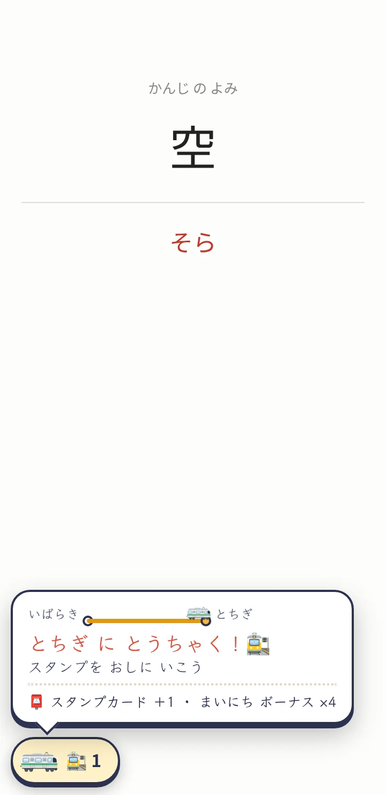
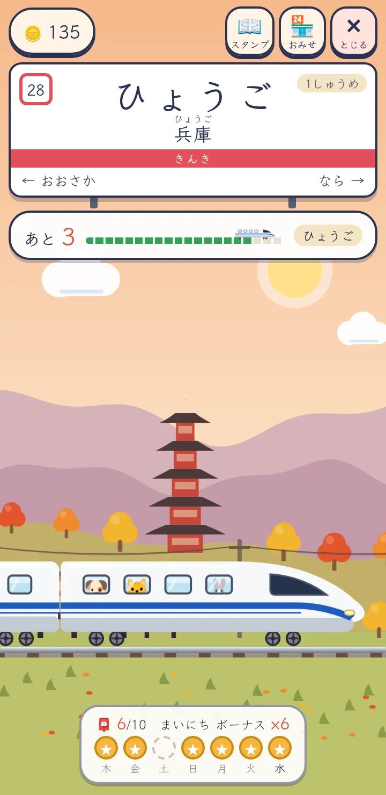
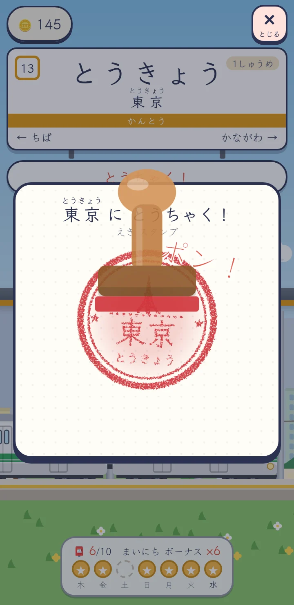
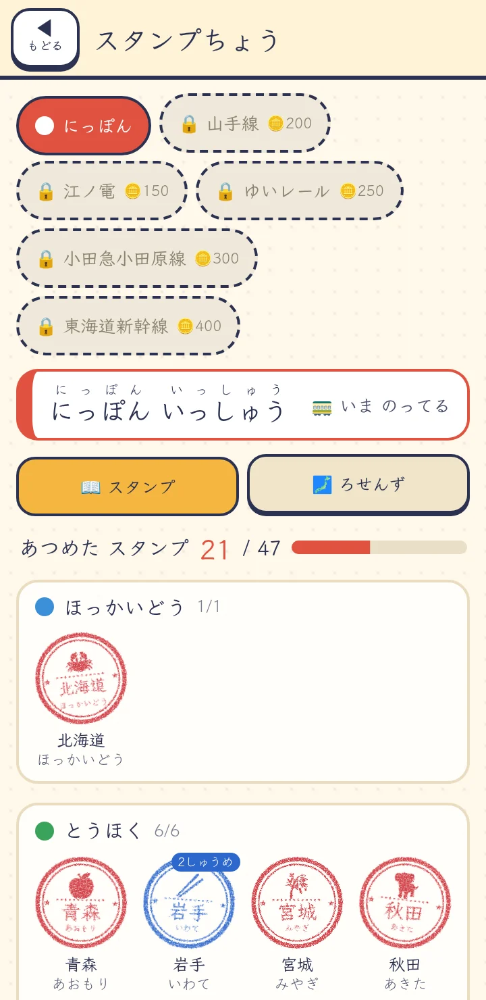
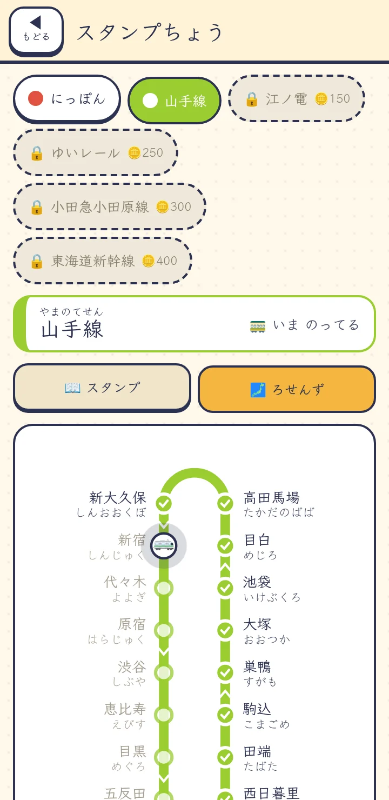
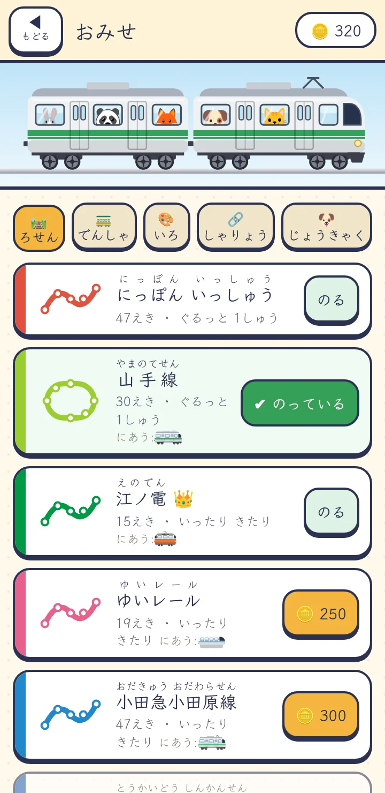
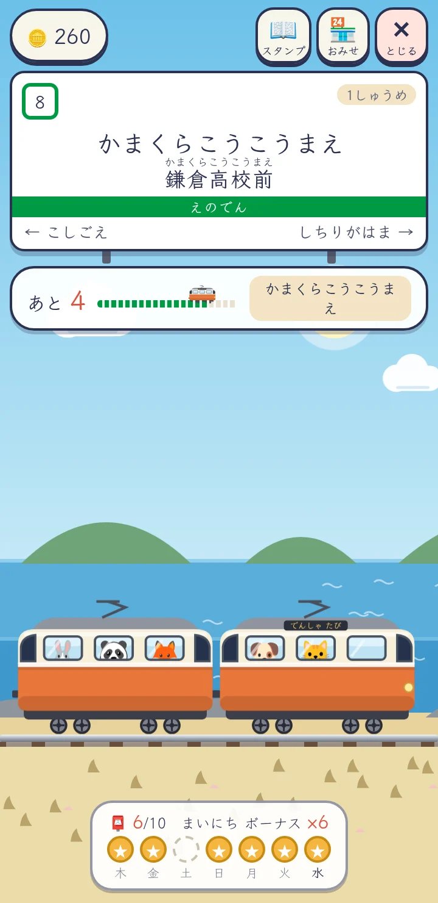
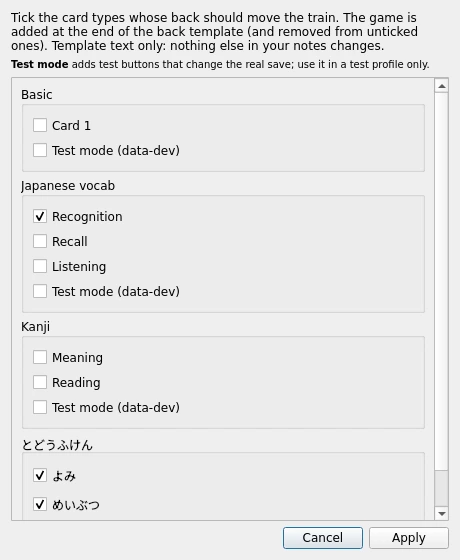

# でんしゃ たび (Train Trip)

A little game on the back of Anki cards, for a child studying on a phone in AnkiDroid. Every card whose answer is
shown moves a drawn train one step along Japan's 47 prefectures, 北海道 → 沖縄 and round again. Each station gives an
eki stamp for the stamp book, a souvenir and coins for the shop: more lines to ride (山手線, 江ノ電, ゆいレール,
小田急小田原線, 東海道新幹線) and the train itself (models, paint, cars, animal passengers).

It knows nothing about the card but its id, so it works on any note type and any deck size: the distance between
stations follows the player's own pace (one ordinary study day ≈ one station), and coins come from stations and
study days, never from card counts. Studying on more days of the week earns a bigger daily bonus, and nothing is
ever lost: no streaks that reset, no timers, nothing random. The full design is in [DESIGN.md](DESIGN.md).

The game's text is Japanese (kana with spaces between words), written for young learners.

## Screenshots

| | | |
|---|---|---|
|  |  |  |
| On the card: an arrival | The trip, here in 近畿 | ポン！ A station's stamp |
|  |  |  |
| The stamp book | 山手線's route map | Lines to buy |



All at phone size (360 × 740).

## Download

Get it from the [releases page](../../releases):

- `densha-tabi-<version>.zip`: everything: the game (`_densha.js`), the desktop add-on
  (`densha-tabi.ankiaddon`), the template snippet, install instructions (`INSTALL.txt`) and an optional sample
  deck, `todoufuken.apkg`: Japan's 47 prefectures in 94 cards (reading the kanji, and guessing the prefecture from
  what it's famous for), with the game already set up.
- `densha-tabi-<version>.ankiaddon`: just the desktop add-on.

## Install

The game runs in **AnkiDroid** (phone) and, with the add-on, in **desktop Anki**. Phone and desktop each keep
their own train (see [Phone and desktop](#phone-and-desktop)).

### Quickest: the sample deck

Import `todoufuken.apkg` (desktop: File → Import; AnkiDroid: ⋮ → Import). It brings the cards, `_densha.js` and
the font, with the game already in the templates. Then do the AnkiDroid settings below (phone) or install the
add-on (desktop).

### Desktop Anki

Needs Anki 2.1.50 or later.

1. Download `densha-tabi-<version>.ankiaddon` from the releases page (it's also inside the zip).
2. In Anki: **Tools → Add-ons → Install from file…**, pick the `.ankiaddon` file, then **restart Anki**.
3. **Tools → でんしゃ たび → Add the train to note types…**: tick the card types whose answer side should move the
   train, then **Apply**. The add-on adds the game to those back templates and puts `_densha.js` in your media
   folder. (One step in Edit → Undo; no full sync needed.)

   

4. Study as usual: on the answer side a small train chip appears bottom-left. Click it to open the game.

The add-on keeps `_densha.js` up to date: a newer add-on replaces an older script (never a newer one), and your
phone gets the new script through sync. **Tools → でんしゃ たび → Remove the train from all note types** takes it
out again; the script and the save stay. Uninstalling the add-on stops the game on desktop (the templates keep
the slot, which then shows nothing on desktop).

On a big window the game opens as a phone-sized column over the reviewer; Esc or a click outside closes it.
Anki's own shortcuts (space, 1–4, …) still work while it's open, and answering closes it. Details:
[DESKTOP.md](DESKTOP.md).

### AnkiDroid (phone)

Needs AnkiDroid 2.23 or later; Android 11 or later is recommended for the emoji.

1. Get the game onto the phone. Any of:
   - set it up on desktop with the add-on (above) and sync; or
   - import the sample deck; or
   - by hand: copy `_densha.js` into the profile's `collection.media` folder (desktop: Tools → Check Media → View
     Files, then sync; the leading `_` keeps Check Media from deleting it), and add this at the end of the
     **back** template of each card type that should move the train:

     ```html
     <div id="densha" data-card="{{CardID}}"></div>
     <script src="_densha.js"></script>
     ```
2. In AnkiDroid's settings, turn on the **new study screen** (Settings → New study screen), and turn on
   **"localStorage in Study Screen"** (Settings → Advanced, under Workarounds). The game saves there; without it
   the card shows a one-line reminder instead of the game.
3. Sync, and study: a small train chip appears bottom-left on the answer side. Tap it to open the game.

The Klee One fonts `_kleeone-regular.ttf` / `_kleeone-semibold.ttf` are used if they're in the media folder (the
sample deck brings them); otherwise the game uses the phone's font.

### Phone and desktop

- **Separate trains.** The phone's save lives in AnkiDroid's localStorage on that phone; the desktop save lives
  in the collection and syncs between desktop computers through AnkiWeb. AnkiDroid's study screen gives card
  scripts nothing that syncs, so the two can't be merged. A card pays once a day on each.
- **Where it shows.** Only while studying: AnkiDroid's new study screen, and desktop Anki's reviewer with the add-on.
  The previewer, browser and card layout screen never show it, so looking at cards there pays nothing.
- **What pays.** A card pays once a day when its answer is shown (the day starts at 04:00, as in Anki); showing
  the answer again or undoing pays nothing. The game can't see which answer button was pressed, so it rewards
  studying, not right answers.
- It can share a card with other card games (it uses `#densha`, `dt-` classes and the `densha-tabi` storage key).

### Test mode

For trying things out without studying for a month: tick **Test mode** for a note type in the add-on's dialog, or
add `data-dev="1"` to the slot by hand. A ⚙ then appears in the game's top bar: 🪙＋50, a past study day for the
stamp card, ＋10 steps, arrive at the next station, move the game's day back or forward, and reset (asks first).
It changes the real save, so use it in a test profile only.

## Development

- `densha.js` is the whole game (one dependency-free IIFE). `sh scripts/build.sh` first refreshes its line data
  from `lines.json` (the block between `LINES-DATA:BEGIN/END`; edit `lines.json`, not that block), then copies it to
  `media/_densha.js`. The lines to buy are described in [LINES.md](LINES.md).
- Tests: `node --test` (Node 20+; `tests/harness.js` is a tiny fake DOM + localStorage running the script in `node:vm`),
  and `python3 -m unittest tests/addon_test.py` for the desktop add-on (`addon/`, stdlib only; `aqt` is stubbed).
- Preview: open `preview.html` in a browser (works from `file://`). It stubs `window.ankidroid`, shows a fake card
  back with the slot, and the strip at the top answers N cards (each a new card swap, as in AnkiDroid), sets the
  CardID and moves the day. `?dev=1` adds `data-dev`; `?strip=none` hides the strip;
  `?garden=<url of _garden.js>` puts [Kanpeki Garden](https://github.com/JHerseth/kanpeki-garden) on the same card
  to check the two games coexist; `?desktop=1` plays desktop Anki with the add-on (no `ankidroid`, the add-on's
  store and card id defined before each card's script; use a desktop-sized window). For the fonts, put copies of
  `_kleeone-*.ttf` next to it.
- Screenshots: `node scripts/shots.mjs [name-filter]` drives headless Chromium at 360×740 (DPR 2) through a set of
  scenes into `out/screens/` (gitignored); `scripts/shot.mjs` takes a single shot of any URL.
- The sample deck: `anki/` holds its note type (templates, CSS) and notes; `scripts/anki_setup.py --profile NAME`
  creates or updates it in the open Anki profile through AnkiConnect and uploads `_densha.js`.
- Release zip: `sh scripts/release.sh 1.0.0 [deck.apkg]` builds, runs the tests and writes
  `dist/densha-tabi-1.0.0.zip` (with `densha-tabi.ankiaddon`, also kept as `dist/densha-tabi-1.0.0.ankiaddon`).

## Licence

MIT, see [LICENSE](LICENSE). The sample deck carries the Klee One font, under the SIL Open Font License
(`OFL-KleeOne.txt` in the zip).
